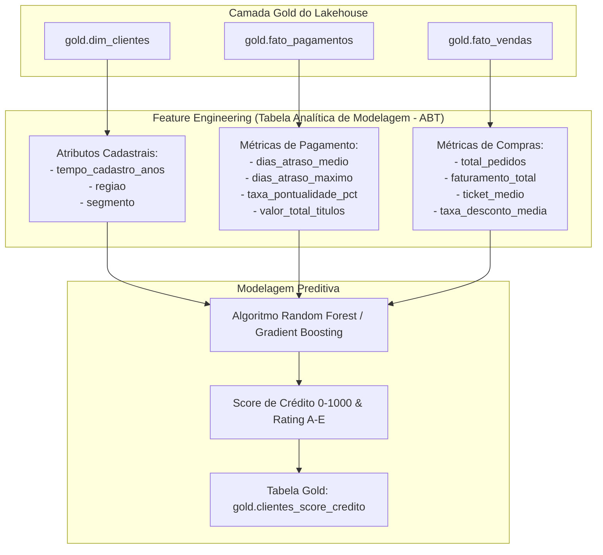

# 📊 Case de Ciência de Dados: Credit Scoring & Predição de Inadimplência B2B
## Da Camada Gold do Lakehouse ao Modelo Preditivo de Risco Financeiro

**Autor:** Jefferson Araújo  
**Etapa:** Ciência de Dados & Machine Learning Aplicado (Credit Risk Analytics)  
**Stack Tecnológica:** Python 3.11, Apache Spark (PySpark), Scikit-Learn, Pandas, Numpy, Delta Lake, Unity Catalog, Databricks SQL  

---

## 🎯 1. O Problema de Negócio (Business Problem)

No modelo de negócios da **OmniB2B Distribuidora**, o faturamento a prazo (via **Boleto Bancário** faturado a 30/60/90 dias) representa a principal alavanca para lojistas e varejistas comprarem em grande volume.

No entanto, essa modalidade traz o maior risco para o fluxo de caixa: **o risco de crédito (Credit Default Risk)**.

### As Dores do Diretor Financeiro (CFO) & Comitê de Crédito:
1. **Perdas Financeiras com PDD (Provisão para Devedores Duvidosos):** A empresa registrou perdas superiores a R$ 2,5 milhões no último exercício com lojistas que receberam a mercadoria e não honraram os boletos.
2. **Critério Manual e Subjetivo de Concessão:** Anteriormente, a liberação de prazo era baseada no feeling dos analistas de crédito ou na insistência do vendedor de campo.
3. **Bloqueio de Bons Clientes (Falso Positivo):** O medo de calote fazia o comitê travar pedidos de lojistas idôneos, derrubando o faturamento comercial.

### A Missão de Data Science:
Construir um **Modelo Preditivo de Credit Scoring (0 a 1000)** integrado diretamente à **Camada Gold** do Lakehouse, que estime a probabilidade de inadimplência de cada cliente antes da aprovação do pedido, gerando ratings automatizados de concessão de crédito.

---

## 🧮 2. Formulação Matemática & Definição do Target

### Tipo de Problema:
Classificação Binária Supervisionada com Calibração de Probabilidades.

### Variável Resposta (Target $Y$):
$$Y_i = \begin{cases} 1, & \text{se o cliente possui histórico de inadimplência ou atraso crítico} > 30 \text{ dias} \\ 0, & \text{se o cliente é adimplente (pagamentos pontuais ou atraso irrelevante)} \end{cases}$$

### Formulação do Credit Score:
A probabilidade prevista pelo modelo, $P(Y=1 \mid X)$, representa a propensão de calote. O **Credit Score Oficial** é escalonado em uma métrica intuitiva de **0 a 1000 pontos**:

$$\text{Score} = \text{round}\Big((1 - P(Y=1 \mid X)) \times 1000\Big)$$

---

## 🏷️ 3. Política de Crédito & Ratings de Risco (Regras de Decisão)

| Faixa de Score | Rating | Classificação de Risco | Política Comercial Automatizada |
| :---: | :---: | :---: | :--- |
| **800 a 1000** | **Rating A** | Risco Muito Baixo | **Crédito Imediato:** Limite ampliado em até 30% e prazo flexível (30/60/90 dias). |
| **650 a 799** | **Rating B** | Risco Baixo | **Aprovação Automática:** Prazo padrão de 30/60 dias dentro do limite cadastral. |
| **500 a 649** | **Rating C** | Risco Moderado | **Aprovação Condicional:** Prazo máximo de 30 dias com limite restrito a R$ 15.000. |
| **350 a 499** | **Rating D** | Risco Alto | **Exigência de Garantia:** 50% de entrada via PIX e saldo restante no boleto. |
| **0 a 349** | **Rating E** | Risco Crítico | **Venda Bloqueada a Prazo:** Apenas pagamento antecipado (PIX / Cartão de Crédito). |

---

## 📐 4. Engenharia de Atributos (Feature Engineering a partir da Gold)

O modelo consome diretamente as tabelas dimensionais e fatos da **Camada Gold**:

---

## 📈 5. Matriz de Custo de Erro (Business Cost Matrix)

Em problemas de risco de crédito, os erros possuem custos assimétricos:
* **Falso Positivo (FP - Erro Tipo I):** O modelo prevê que o cliente é mau pagador, mas ele pagaria em dia.
  * *Custo:* Lucro cessante da venda recusada (~15% a 25% de margem líquida).
* **Falso Negativo (FN - Erro Tipo II):** O modelo prevê que o cliente é bom pagador, mas ele dá calote.
  * *Custo:* **100% do valor do pedido perdido** (custo do produto + imposto + logística).

> **Princípio:** Um Falso Negativo custa cerca de **4x a 5x mais** para a empresa do que um Falso Positivo. Por isso, otimizamos o modelo para maximizar o **Recall de Inadimplência** e a **Área sob a Curva Precision-Recall (PR-AUC)**, garantindo que o calote seja capturado com antecedência.

---

## 🚀 6. O Produto de Dados Final (Data Product)

Os resultados do modelo não ficam isolados em um script Jupyter. Eles são gravados de volta no catálogo Lakehouse na tabela gerenciada Delta Lake:
* **`projeto_crm_ecommerce.gold.clientes_score_credito`**

Dessa forma, os analistas de crédito e os dashboards de vendas no **Power BI / Databricks SQL** consomem as faixas de rating atualizadas em tempo real para tomadas de decisão na ponta!
