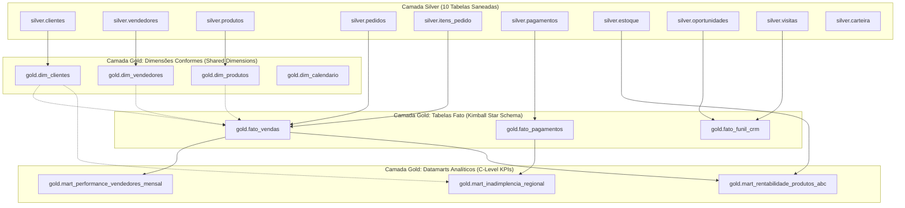

# 🥇 Case de Negócio: Da Silver à Gold (Arquitetura Medalhão no Databricks)
## Modelagem Dimensional (Star Schema) e Datamarts Executivos para Tomada de Decisão

**Autor:** Jefferson Araújo  
**Etapa:** Camada Gold (Curadoria Analítica, Modelagem Kimball e Indicadores C-Level)  
**Stack Tecnológica:** Python 3.11, Apache Spark (PySpark), Delta Lake, Databricks Serverless, Unity Catalog, Power BI / Databricks SQL  

---

## 🎯 1. O Desafio de Negócio (Business Problem Statement)

A **OmniB2B Distribuidora** opera no segmento de cosméticos e perfumaria atendendo milhares de lojistas em todo o Brasil. Historicamente, a empresa sofria com um grande abismo de governança entre duas fontes vitais de dados:

1. **CRM de Campo:** Força de vendas externa que registra visitas presenciais, carteira de clientes e pipeline de oportunidades.
2. **ERP Financeiro/Operacional:** Faturamento de pedidos, controle de estoque em centro de distribuição e cobrança de títulos/boletos.

### As Dores dos Stakeholders:
* **Diretoria Comercial:** Reuniões de fechamento de mês eram marcadas por divergências. O CRM apontava R$ 120 milhões em oportunidades "ganhas", mas o ERP registrava pedidos cancelados, pedidos com devolução de itens e vendedores que pareciam bater metas no sistema de vendas sem o correspondente faturamento líquido faturado.
* **Diretoria de Operações & Logística:** Produtos de alta saída sofriam rupturas frequentes de estoque por falta de visibilidade entre o ciclo de vendas e o saldo em armazém.
* **Diretoria Financeira (CFO):** Atrasos nos pagamentos e inadimplência de boletos estavam corroendo o fluxo de caixa, sem que houvesse clareza de quais regiões ou formas de pagamento concentravam o maior risco.

### A Missão da Engenharia de Dados na Camada Gold:
Transformar as 10 tabelas limpas e normalizadas da **Camada Silver** em um **Data Lakehouse Analítico de Alta Performance**, implementando **Modelagem Dimensional (Star Schema)** e **Datamarts Pré-Agregados** para responder às 4 perguntas centrais de negócio com latência de segundos no Power BI e Databricks SQL.

---

## ❓ 2. As 4 Perguntas Estratégicas que a Camada Gold Responde

```
┌───────────────────────────────────────────────────────────────────────────────┐
│                           PERGUNTAS DIRETIVAS (C-LEVEL)                       │
├───────────────────────────────────────────────────────────────────────────────┤
│ 1. [COMERCIAL]   Qual o faturamento líquido real e % de meta batida por       │
│                  vendedor, mês a mês, expurgando cancelamentos e devoluções?  │
│                                                                               │
│ 2. [PRODUTOS]    Quais produtos formam a Curva ABC de receita e margem, e     │
│                  quais deles estão atualmente em risco de ruptura de estoque? │
│                                                                               │
│ 3. [FUNIL CRM]   Qual a eficiência real do funil: de Visitas para Oportunidades│
│                  e de Oportunidades para Pedidos Efetivos (Lead-to-Cash)?     │
│                                                                               │
│ 4. [FINANCEIRO]  Qual a taxa de inadimplência por região e forma de pagamento,│
│                  e qual o valor financeiro total em risco de perda?           │
└───────────────────────────────────────────────────────────────────────────────┘
```

---

## 📐 3. Arquitetura da Camada Gold: Star Schema & Datamarts

A Camada Gold é construída sobre dois pilares complementares recomendados pelas melhores práticas de Engenharia de Dados corporativas:



---

## 🏗️ 4. Especificação Técnica dos Modelos da Camada Gold

### 4.1. Dimensões Conformes

#### `gold.dim_clientes`
* **Grão:** 1 linha por cliente cadastrado.
* **Origem:** `silver.clientes`.
* **Atributos:** `cliente_id`, `cnpj`, `razao_social`, `segmento`, `cidade`, `uf`, `regiao`, `data_cadastro`, `ano_cadastro`, `fl_ativo`.

#### `gold.dim_vendedores`
* **Grão:** 1 linha por vendedor.
* **Origem:** `silver.vendedores`.
* **Atributos:** `vendedor_id`, `nome`, `regiao`, `uf`, `data_admissao`, `data_desligamento`, `meta_mensal`, `fl_ativo`.

#### `gold.dim_produtos`
* **Grão:** 1 linha por SKU de produto.
* **Origem:** `silver.produtos`.
* **Atributos:** `sku`, `descricao`, `categoria`, `marca`, `nota_olfativa`, `preco_tabela`, `custo_unitario`, `margem_bruta_tabela`, `margem_pct_tabela`, `fl_ativo`.

#### `gold.dim_calendario`
* **Grão:** 1 linha por data contínua cobrindo todo o período transacional (2020 a 2026).
* **Atributos:** `data`, `ano`, `mes`, `nome_mes`, `ano_mes`, `trimestre`, `dia_semana`, `nome_dia_semana`, `fl_fim_de_semana`.

---

### 4.2. Tabelas Fato (Kimball)

#### `gold.fato_vendas`
* **Grão:** 1 linha por item de pedido faturado (`pedido_id` + `item_id`).
* **Origens:** `silver.pedidos` + `silver.itens_pedido` + `silver.produtos`.
* **Regras de Negócio Críticas:**
  - `valor_liquido_item`: `valor_bruto * (1 - desconto_pct / 100)`.
  - `custo_total_item`: `quantidade * custo_unitario`.
  - `lucro_bruto_item`: `valor_liquido_item - custo_total_item`.
  - Filtro / Flags: Sinalização clara de `fl_cancelado` e `fl_devolucao`.
* **Chaves Estrangeiras:** `cliente_id`, `vendedor_id`, `sku`, `data_pedido`.

#### `gold.fato_funil_crm`
* **Grão:** 1 linha por oportunidade comercial.
* **Origens:** `silver.oportunidades`.
* **Atributos & Métricas:** `oportunidade_id`, `cliente_id`, `vendedor_id`, `origem`, `etapa`, `data_abertura`, `data_fechamento`, `probabilidade_pct`, `valor_estimado`, `ciclo_dias`, `fl_ganha`, `fl_perdida`, `fl_em_aberto`.

#### `gold.fato_pagamentos`
* **Grão:** 1 linha por parcela de pagamento.
* **Origens:** `silver.pagamentos` + `silver.pedidos`.
* **Atributos & Métricas:** `pagamento_id`, `pedido_id`, `cliente_id`, `data_vencimento`, `data_pagamento`, `forma_pagamento`, `status_pagamento`, `valor`, `taxa_pct`, `valor_liquido`, `dias_atraso`, `fl_pago`, `fl_atrasado`, `fl_inadimplente`.

---

### 4.3. Datamarts Executivos (Métricas Pré-Agregadas)

#### 📊 Datamart 1: `gold.mart_performance_vendedores_mensal`
Consolida o faturamento líquido faturado (apenas pedidos válidos e não cancelados) e compara com a meta estipulada para cada vendedor por competência mensal (`ano_mes`).
* **Campos:** `ano_mes`, `vendedor_id`, `nome_vendedor`, `regiao`, `meta_mensal`, `faturamento_liquido`, `total_pedidos`, `ticket_medio`, `percentual_atingimento_meta`, `status_atingimento` (`"Superou Meta"`, `"Na Meta (>=90%)"`, `"Abaixo da Meta"`).

#### 📦 Datamart 2: `gold.mart_rentabilidade_produtos_abc`
Cruza o faturamento total acumulado com o custo de aquisição e o saldo de estoque atual da filial para prevenir rupturas dos itens mais lucrativos.
* **Campos:** `sku`, `descricao`, `categoria`, `marca`, `quantidade_vendida`, `receita_liquida_total`, `custo_total`, `lucro_bruto_total`, `margem_real_pct`, `saldo_estoque_atual`, `fl_risco_ruptura` (produto no top de vendas com estoque zerado ou em ruptura).

#### 💳 Datamart 3: `gold.mart_inadimplencia_regional`
Monitora o volume financeiro inadimplente e a média de dias de atraso por Estado (UF) e forma de pagamento, orientando a política de concessão de crédito.
* **Campos:** `regiao`, `uf`, `forma_pagamento`, `total_titulos`, `valor_total_emitido`, `valor_recebido`, `valor_inadimplente`, `taxa_inadimplencia_pct`, `media_dias_atraso`.

---

## 🚀 5. Impacto do Projeto para Portfólio de Engenharia de Dados

| Critério de Avaliação Sênior | Como Este Projeto Responde |
| :--- | :--- |
| **Visão de Negócio (Business Acumen)** | Não constrói tabelas técnicas vazias; resolve problemas de conciliação de faturamento e risco de crédito para executivos. |
| **Modelagem de Dados (Kimball)** | Aplica Star Schema com grão atômico estrito, dimensões conformes compartilhadas e fatos acumuladas/transacionais. |
| **Performance & Otimização** | Tabelas Delta particionadas com `Z-ORDER` / `OPTIMIZE`, evitando scans desnecessários em queries de BI. |
| **Governança & Linhagem** | Catálogo gerenciado (`workspace.gold`), tipos fortes (`DecimalType`, `DateType`, `BooleanType`) e colunas de auditoria (`_gold_timestamp`). |
| **Código Limpo & Reprodutível** | Arquitetura executável tanto localmente com Spark 3.5 quanto no Databricks Unity Catalog sem alterações de código. |
